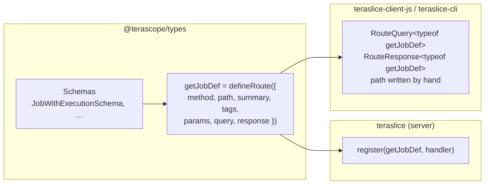
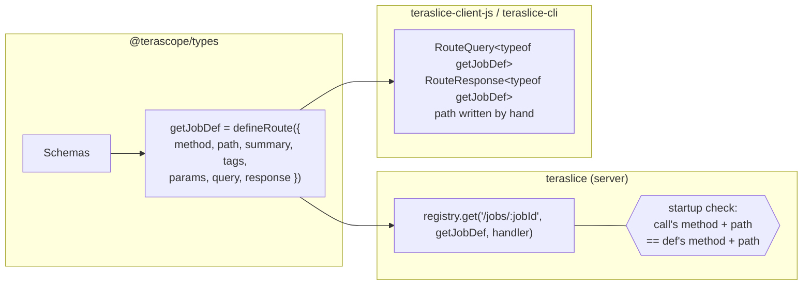
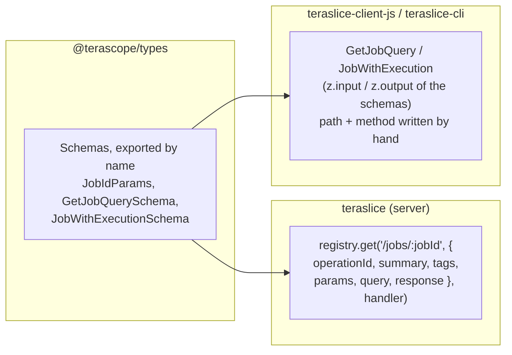

# /v2 API: where route definitions live

**Question:** where should each piece of a /v2 route live? v1 shows the method, the path and
the handler together in one call. In the v2 setup on this branch, the method and path are in
`@terascope/types`, away from the handler. We want to get v1's readability back without
losing much of what the shared route defs give us.

We compare three setups using one example endpoint, `GET /v2/jobs/:jobId`. Both options are
in the working tree for that one endpoint (marked `// OPTION 1` and `// OPTION 2`), with
Option 1 active.

For reference, the same route in v1 (`api.ts`):

```ts
v1routes.get('/jobs/:jobId', (req, res) => {
    const { ex } = req.query;
    const { jobId } = req.params;
    ...
});
```

---

## Original: the whole def lives in `@terascope/types`



```ts
// teraslice: api-v2.ts
register(getJobDef, async ({ params: { jobId }, query: { ex } }) => {
    ...
}, { errorMessage: 'Could not retrieve job' });
```

- The server and clients share one def, so request and response types are checked at
  compile time on both sides.
- Reading `api-v2.ts`, you can't tell that this is `GET /jobs/:jobId` without opening
  `teraslice-api.ts`.

---

## Option 1: keep the def in types; repeat method and path in the call



```ts
// @terascope/types: teraslice-api.ts (unchanged from the original)
export const getJobDef = defineRoute({
    operationId: 'getJob',
    method: 'get',
    path: '/jobs/:jobId',
    summary: 'Get a job',
    tags: ['Jobs'],
    params: JobIdParams,
    query: z.strictObject({ ex: z.string().optional().meta({ ... }) }),
    response: JobWithExecutionSchema,
});

// teraslice: api-v2.ts
registry.get('/jobs/:jobId', getJobDef, async ({ params: { jobId }, query: { ex } }) => {
    ...
}, { errorMessage: 'Could not retrieve job' });

// teraslice-client-js: job.ts
async config(
    query: RouteQuery<typeof getJobDef> = {},
    searchOptions: RequestOptions = {}
): Promise<RouteResponse<typeof getJobDef>> {
    return this.get(`/jobs/${this._jobId}`, this.makeOptions(query, searchOptions));
}
```

- The method and path are written twice, but a mismatch fails `ApiService` startup:
  `v2 route GET /jobs/:jobId: registered as PUT /jobs/:jobId`.
- The client side is the same as in the original.
- The summary, tags and schemas still live in types, away from the handler.

---

## Option 2 (the "middle ground"): shared schemas in types, route defined in teraslice



```ts
// @terascope/types: teraslice-api.ts
export const JobIdParams = z.strictObject({ jobId: z.string() });
export const GetJobQuerySchema = z.strictObject({ ex: z.string().optional().meta({ ... }) });
export type GetJobQuery = z.input<typeof GetJobQuerySchema>;
export type JobWithExecution = z.output<typeof JobWithExecutionSchema>;

// teraslice: api-v2.ts
registry.get('/jobs/:jobId', {
    operationId: 'getJob',
    summary: 'Get a job',
    tags: ['Jobs'],
    params: JobIdParams,
    query: GetJobQuerySchema,
    response: JobWithExecutionSchema,
}, async ({ params: { jobId }, query: { ex } }) => {
    ...
}, { errorMessage: 'Could not retrieve job' });

// teraslice-client-js: job.ts
async config(
    query: GetJobQuery = {},
    searchOptions: RequestOptions = {}
): Promise<JobWithExecution> {
    return this.get(`/jobs/${this._jobId}`, this.makeOptions(query, searchOptions));
}
```

- The method, path, summary, tags, the choice of schemas and the handler are all in one
  call, like v1.
- Clients still get compile-time request and response types, as long as every query, body
  and response schema is a named export in types.
- No shared object pairs a path with its schemas, so the client can't check that it's
  calling the right path or method.

---

## Side by side

|                                              | Original                     | Option 1                                 | Option 2                                  |
| -------------------------------------------- | ---------------------------- | ---------------------------------------- | ----------------------------------------- |
| Method + path                                | types                        | types **and** teraslice (checked)        | teraslice                                 |
| operationId, summary, tags                   | types                        | types                                    | teraslice                                 |
| Request/response schemas                     | types                        | types                                    | types (named exports)                     |
| Route + handler visible together             | no                           | method + path only                       | **yes**                                   |
| Client: query/body/response checked at compile time | yes                   | yes                                      | yes, if schemas are exported              |
| Client: path/method tied to the server       | possible (`getJobDef.path`)¹ | possible (`getJobDef.path`)¹             | **no**, hand-written                      |
| Duplication                                  | none                         | method + path (checked at startup)       | path + method in client                   |
| Exports per route in types                   | 1 def                        | 1 def                                    | 1 per route-specific schema (+ aliases)   |
| `defineRoute` / `Route*` helpers live in     | types                        | types                                    | could move to teraslice (server-only)     |
| Plan doc changes                             | none                         | small (Phase 1 note)                     | Goal #4, Phase 1, Phase 3 "each step"     |

¹ Today the client builds the URL by hand in every setup. Using `def.path` would need a small
helper that fills in `:jobId`. That's only possible when the client has the def, so not in
Option 2.

## What happens when the server changes

Example: a teraslice developer changes `GET /jobs/:jobId`.

| Change                                  | Original / Option 1                            | Option 2                                                     |
| --------------------------------------- | ---------------------------------------------- | ------------------------------------------------------------ |
| Rename query param `ex` → `fields`      | client stops compiling                         | client stops compiling (shared `GetJobQuerySchema`)          |
| Add a required field to the response    | client types update                            | client types update                                          |
| Route uses an inline, unexported schema | n/a: the def carries it                        | client has no type, writes its own copy, can drift silently |
| Rename the path                         | silent today¹; Option 1 startup check keeps server + def in sync | silent; client gets a 404 at runtime              |
| Change the method                       | silent today¹                                  | silent; client gets a 404 at runtime                         |

Because v2 rejects unknown query params with a 400, a client sending an old param fails loudly
at runtime rather than getting wrong data. With compile-time checks, it fails earlier instead.

## Found while trying this (applies to every option)

Typing the client against the v2 response showed that **a stored job has no defaults filled
in**. `workers`, `active` and so on can be missing. The client's `updatePartial` and the
CLI's `JobMetadata.config` both assumed a full `JobConfig`. The CLI reads `job.config.workers`
as the expected worker count in `jobs.ts` (watch check), and that is `undefined` for a job
submitted without `workers`. Both spots have a cast and a comment for now. This is the
fallout the plan expected under "Casts from v1 record types".

## Discussion points

1. How much do we value seeing v1-style routes in `api-v2.ts`, compared with clients being
   tied to the server's paths at compile time?
2. Under Option 2, do we enforce "every route-specific schema is a named export in types"?
   With a lint rule, a test, or review only?
3. Under Option 2, do we keep the `GetJobQuery` / `JobWithExecution` aliases? The plan
   currently says v2 types are read off route defs, not declared as aliases.
4. Do clients need path checking at all, or are e2e tests enough? Path and method changes
   are rare and fail with a clear 404.
5. Naming convention for exported schemas (`GetJobQuerySchema` follows the `operationId`).
